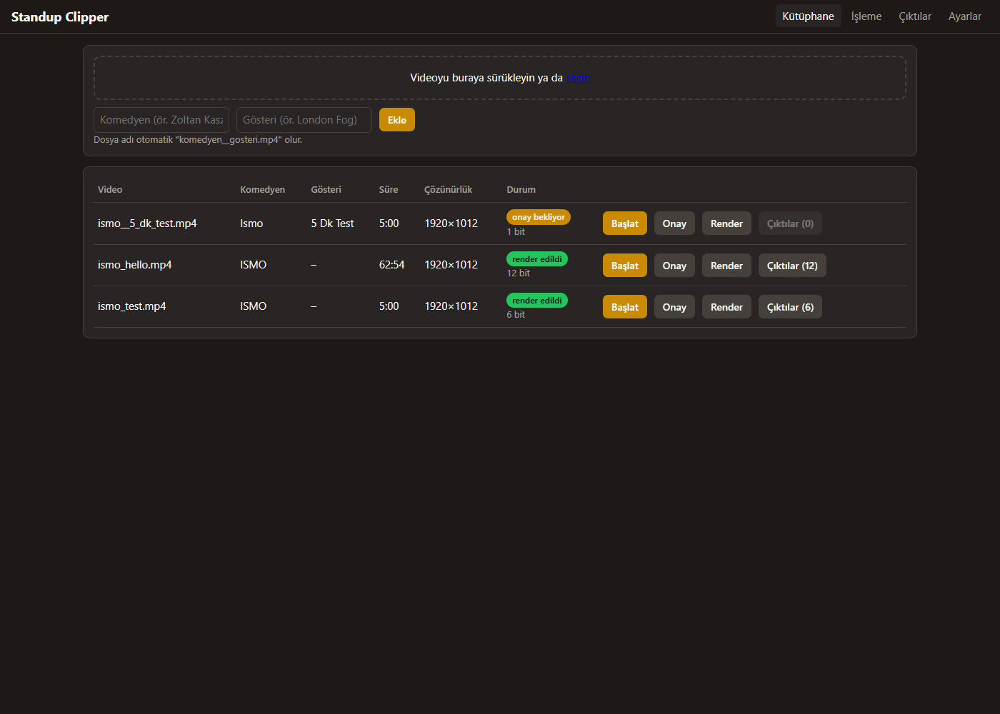

# standup-clipper

Bilgisayardaki bir stand-up videosundan en komik bitleri **seyirci kahkahasına** bakarak bulur,
Claude ile seçip Türkçeye çevirir ve **Türkçe karaoke altyazılı 9:16 dikey** kısa videolar üretir.
Tamamen yerelde çalışır (Whisper + kahkaha modeli + ffmpeg); yalnızca seçim ve çeviri için Claude'a metin gönderilir.



> **Not:** Bu araç yalnızca yerel video dosyalarını işler. İşlediğiniz içerik için gerekli haklara sahip
> olmak kullanıcının sorumluluğundadır.

**Hızlı kurulum:** Python 3.11, PATH'te ffmpeg ve NVIDIA GPU (önerilir) gerekir. Aşağıdaki
[Kurulum](#kurulum-adım-adım) adımlarıyla `.venv` oluşturup bağımlılıkları ve modelleri kurun, sonra
`Baslat.bat`'a çift tıklayın; panel tarayıcıda açılır.

```
video.mp4 → ses → transkript → kahkaha → adaylar → Claude seçimi → kaçan konuşmayı kurtarma
          → Claude çevirisi (+ kapsama kontrolü) → Claude çeviri kontrolü → Claude paylaşım açıklaması → ASS altyazı
          → çekim bazlı yüz takipli crop → [onay sayfası]
          → render: kes/kırp → [Real-ESRGAN] → 1080x1920 → altyazı (mp4 + açıklama .txt)
```

## Gereksinimler

- Windows 10/11, **Python 3.11**
- **ffmpeg** PATH'te (libass içeren "full" sürüm; ör. `winget install Gyan.FFmpeg`)
- NVIDIA GPU önerilir (Whisper large-v3). GPU yoksa otomatik CPU + int8 + `medium`.
- Claude: varsayılan `cli` modu için [Claude Code](https://claude.com/claude-code) kurulu ve giriş yapılmış olmalı
  (`claude` komutu çalışmalı). `api` modu için Anthropic API anahtarı.

## Kurulum (adım adım)

```powershell
cd standup-clipper
py -3.11 -m venv .venv
.venv\Scripts\activate
python -m pip install --upgrade pip
pip install -r requirements.txt
```

Modeller ve font (bir kez):

```powershell
mkdir models, fonts
curl.exe -L -o models\yamnet.tflite https://storage.googleapis.com/mediapipe-models/audio_classifier/yamnet/float32/1/yamnet.tflite
curl.exe -L -o models\blaze_face_short_range.tflite https://storage.googleapis.com/mediapipe-models/face_detector/blaze_face_short_range/float16/1/blaze_face_short_range.tflite
curl.exe -L -o models\blaze_face_full_range.tflite https://storage.googleapis.com/mediapipe-models/face_detector/blaze_face_full_range/float16/1/blaze_face_full_range.tflite
curl.exe -L -o models\pose_landmarker_lite.task https://storage.googleapis.com/mediapipe-models/pose_landmarker/pose_landmarker_lite/float16/1/pose_landmarker_lite.task
curl.exe -L -o fonts\Montserrat-ExtraBold.ttf https://github.com/JulietaUla/Montserrat/raw/master/fonts/ttf/Montserrat-ExtraBold.ttf
git clone --depth 1 https://github.com/jrgillick/laughter-detection models\laughter-detection
```

Real-ESRGAN (kalite yükseltme, isteğe bağlı). `realesr-general-x4v3` resmi ncnn paketinde olmadığı için
PyTorch ağırlığı bir kez ncnn'e dönüştürülür:

```powershell
curl.exe -L -o $env:TEMP\resrgan.zip https://github.com/xinntao/Real-ESRGAN/releases/download/v0.2.5.0/realesrgan-ncnn-vulkan-20220424-windows.zip
Expand-Archive $env:TEMP\resrgan.zip models\realesrgan
curl.exe -L -o models\realesr-general-x4v3.pth https://github.com/xinntao/Real-ESRGAN/releases/download/v0.2.5.0/realesr-general-x4v3.pth
pip install pnnx
python tools\convert_realesrgan.py models\realesr-general-x4v3.pth models\realesrgan\models
```

Whisper modeli (~3 GB) ilk çalıştırmada otomatik indirilir.

`api` modunu kullanacaksanız `.env.example` dosyasını `.env` olarak kopyalayıp `ANTHROPIC_API_KEY` girin
ve `config.yaml` içinde `claude.mode: api` yapın.

## Web arayüzü (önerilen)

Proje kökündeki `Baslat.bat`'a çift tıklayın; panel
http://127.0.0.1:8770/ adresinde açılır (yalnızca bu bilgisayardan erişilebilir).

- **Kütüphane:** `samples/` içindeki videolar, süre, çözünürlük ve durum. Sürükle-bırak ile video ekleme
  (dosya adı otomatik `komedyen__gosteri.mp4`). 720p altı videolarda kırmızı uyarı. Satıra tıklayınca
  komedyen ve gösteri adı düzenlenir (açıklamadaki 🎤 satırında kullanılır).
- **İşleme:** adım adım ilerleme, süreler ve canlı log. Hata olursa Türkçe özet ve "Kaldığı yerden devam et".
  Claude limiti dolarsa "Claude limiti doldu" uyarısı ve isteğe bağlı otomatik yeniden deneme (30 dk arayla).
- **Onay:** her klipte kaynak videodan o aralığı oynatan önizleme, altyazısız kelimeler kırmızı,
  düzenlenebilir paylaşım açıklaması, "Kaydet ve render et".
- **Çıktılar:** klipler tarayıcıda oynatılır; açıklama + hashtag kopyalama, "Klasörde göster",
  YouTube/Instagram/TikTok paylaşım takibi, "henüz paylaşılmamış" filtresi ve "Açıklamaları yeniden yaz"
  (yalnız `.txt`'ler güncellenir, video yeniden render edilmez).
- **Ayarlar:** önemli `config.yaml` ayarları form olarak (yorumlar korunarak kaydedilir).

İşler sırayla, tek tek çalışır; durum `work/_jobs.json`'da tutulur, sunucu kapanıp açılsa da kaybolmaz.
Elle başlatma: `python -m clipper.web --open`.

## Kullanım (komut satırı)

```powershell
# 1–8. adımlar, sonunda tarayıcıda onay sayfası açılır
python main.py run samples\gosteri.mp4 --comedian "Komedyen Adı"

# Onay sayfasında: render edilecek klipleri işaretleyin, hook başlığını ve altyazı satırlarını düzeltin,
# "Kaydet"e basın, terminalde Ctrl+C ile sunucuyu kapatın. Sonra:
python main.py render samples\gosteri.mp4

# Düzen ve kalite yükseltme (varsayılanlar config.yaml'da):
python main.py render samples\gosteri.mp4 --layout blur_bg
python main.py render samples\gosteri.mp4 --layout crop --upscale always

# Klasördeki tüm videoları sırayla işle (onay sayfası açılmaz; komedyen adı dosya adından:
# "zoltan_kaszas__london_fog.mp4" → "Zoltan Kaszas"). Sonra istediğiniz videonun onay sayfasını açın:
python main.py run-all samples
python main.py review samples\zoltan_kaszas__london_fog.mp4

# Açıklamaları yeniden yaz (out/ içindeki .txt'ler güncellenir, render yok):
python main.py captions samples\gosteri.mp4

# Tek bir adımı yeniden çalıştırmak (önceki adımlar cache'ten gelir):
python main.py step translate samples\gosteri.mp4
```

Adım adları: `audio, transcribe, laughter, candidates, select, gapfill, translate, proofread, subtitles, reframe, render, review`.

### Düzenler

- `crop` — yüz takipli 9:16 kırpma. Kamera açısı değişimleri PySceneDetect ile bulunur, her çekimin kırpma
  konumu ayrı hesaplanır.
- `blur_bg` — yatay video 1080 genişlikte ortada; arka planı aynı videonun bulanık hali doldurur. Hook ve
  notlar üstteki boşlukta, altyazı videonun hemen altında.

### Kalite yükseltme (Real-ESRGAN)

Varsayılan olarak kapalı (`upscale.mode: "off"`; telefon ekranında fark görünmedi). `auto` iken kırpılan alan 1920 pikselden kısaysa (ör. 1080p kaynakta 1012 px) onaylanan
klipler `realesr-general-x4v3` ile büyütülür; tam gösteri asla işlenmez. Kareler `work/{video}/frames/{n}/`
altına çıkarılır, işlem bitince silinir (`upscale.keep_frames`). RTX 4060'ta ~7.9 kare/sn
(85 sn'lik klip: büyütme ~4.3 dk, toplam ~5.3 dk). blur_bg düzeninde video zaten küçültüldüğü için büyütme yapılmaz.

### Çıktılar

| Yer | İçerik |
|---|---|
| `work/{video}/audio.wav` | 16 kHz mono ses |
| `work/{video}/words.json`, `segments.json` | Kelime zaman damgalı transkript |
| `work/{video}/laughter.json` | `[{start, end, prob}]` kahkaha aralıkları |
| `work/{video}/candidates.json` | En iyi 40 aday (cümle başından kahkaha sonuna) |
| `work/{video}/selected.json` | Claude'un seçtiği bitler (puan, gerekçe, ekrandaki hook) |
| `work/{video}/gapfill.json` | Whisper'ın atladığı, VAD'sız yeniden transkripsiyonla kurtarılan kelimeler |
| `work/{video}/translations.json` | Zamana hizalı Türkçe ifade grupları, açıklama notları, ABD→TR uyarlama listesi |
| `work/{video}/translations_checked.json` | Çeviri kontrolünden geçmiş hali + yapılan değişiklikler (altyazı ve onay sayfası bunu kullanır) |
| `work/{video}/captions.json` | Bit başına paylaşım açıklaması (onay sayfasında düzenlenebilir) |
| `work/{video}/subs/{n}.ass` | Karaoke altyazı |
| `work/{video}/reframe.json` | 9:16 crop kutusu + çekim bazlı x konumları |
| `work/{video}/review.json` | Onaylanan klipler |
| `work/{video}/timings.json` | Her adımın süresi |
| `out/{video}/{n}_{hook}.mp4` + `.txt` | Dikey video + açıklama: merak uyandıran tek satır, 🎤 komedyen – gösteri, 5 hashtag |

**Cache:** Her adımın JSON çıktısı varsa yeniden hesaplanmaz. Bir adımı zorla yeniden yapmak için `step`
komutunu kullanın; sonraki adımları da güncellemek isterseniz onları da sırayla `step` ile çalıştırın.

## Ayarlar (`config.yaml`)

Tüm modeller, eşikler, klip uzunlukları, font, renkler ve Claude modu buradadır. Sık değiştirilenler:

- `laughter.threshold` — kahkaha bulunamıyorsa düşürün (ör. 0.35), fazla buluyorsa yükseltin.
- `select.per_minutes`, `select.max_bits`, `select.min_score` — her 5 dakikaya en fazla 1 bit, üst sınır 12, 6 puan altı elenir.
- `candidates.pause` — bundan uzun duraklamalar da cümle sınırı sayılır; klipler yalnızca cümle başında başlar.
- `laughter.stride` — GPU'da (CUDA torch) 1 önerilir (5 dk ses ~15 sn). CPU'da 4 yapın (~4 kat hızlı).
- `safe_zone` — Instagram/TikTok/Shorts arayüzünün kapatmadığı alan: altyazı ve notlar y=1050–1450 bandında,
  soldan 60, sağdan 140 px boşlukla. `subs.size` altyazı boyutu, `subs.credit_y` üstteki komedyen adının yeri.
- `claude.mode` — `cli` (aboneliğiniz, ek ücret yok) veya `api`.

## Notlar

- **Kahkaha modeli:** `jrgillick/laughter-detection` kullanılır. Orijinal script eski sürümlere bağlı
  (torch 1.3, librosa 0.8) olduğundan doğrudan çalışmaz; `clipper/laughter.py` yalnızca reponun model
  tanımını ve checkpoint'ini kullanır, özellik çıkarımını yeni librosa API'siyle yapar. Model yüklenemezse
  otomatik olarak YAMNet'in (MediaPipe) kahkaha sınıflarına geçer (`laughter.backend: yamnet` ile zorlanabilir).
- **Crop:** Kamera açısı değişince kadraj atlar; çekim içinde ölü bölgeli takip yapılır: yüz kırpılan alanın
  orta %40'ındayken kadraj durur, dışına çıkacaksa yumuşakça kayar (`reframe.center_band`). Önce yakın çekim,
  yüz bulunamazsa uzak mesafe (full range) yüz modeli, o da bulamazsa MediaPipe pose ile gövde merkezi denenir;
  karenin alt kısmındaki yüzler seyirci sayılıp elenir (`reframe.max_face_y`). Yüz bulunamayan karelerde son
  bulunan konum, hiç yüz olmayan çekimde bir önceki çekimin konumu kullanılır.
- **Güvenli alan:** Hook ve komedyen adı üstte (hook 3 sn sonra kaybolur, ad kalır); altyazı ve notlar
  platform arayüzünün (alt ~%20, sağ ~%12) dışında kalan `safe_zone` bandında.
- **Altyazı kapsaması:** Her Whisper kelimesi bir altyazı grubunda olmalı; eksik varsa çeviri eksik kelimeler
  belirtilerek yeniden istenir, 2 denemede düzelmezse onay sayfasında kırmızıyla işaretlenir. Ayrıca seçilen
  bitlerdeki kelimesiz boşluklar VAD kapalı yeniden transkribe edilir (`gapfill`).
- **Yedek:** Proje git deposudur; `samples/`, `work/`, `out/`, `models/`, `.venv/`, `.env` hariç tutulur.
- **Loglar:** Konsol + `clipper.log`. Her Claude çağrısının süresi (api modunda token ve maliyet) loglanır.

## Kullanılan modeller ve lisansları

Model dosyaları **depoda yoktur** (`models/` git dışıdır). Whisper modeli ilk çalıştırmada otomatik
indirilir; diğerleri [Kurulum](#kurulum-adım-adım) bölümündeki komutlarla bir kez indirilir.

| Model / bileşen | Kullanım | Lisans |
|---|---|---|
| [faster-whisper](https://github.com/SYSTRAN/faster-whisper) + Whisper large-v3 ağırlıkları | Transkript | MIT |
| [jrgillick/laughter-detection](https://github.com/jrgillick/laughter-detection) | Kahkaha tespiti | MIT |
| [MediaPipe](https://github.com/google-ai-edge/mediapipe) (BlazeFace, Pose Landmarker, YAMNet) | Yüz/kişi tespiti, yedek kahkaha tespiti | Apache 2.0 |
| [Real-ESRGAN](https://github.com/xinntao/Real-ESRGAN) (`realesr-general-x4v3`) + realesrgan-ncnn-vulkan | İsteğe bağlı kalite yükseltme | BSD-3-Clause / MIT |
| [Montserrat](https://github.com/JulietaUla/Montserrat) (`fonts/`) | Altyazı fontu | SIL OFL 1.1 ([fonts/OFL.txt](fonts/OFL.txt)) |

Proje kodu MIT lisanslıdır ([LICENSE](LICENSE)).

## Testler

```powershell
python -m pytest
```

Arayüz uçtan uca testi (gerçek pipeline, tarayıcıdan tıklayarak; ekran görüntüleri `work/screenshots/`):

```powershell
python tools\ui_e2e.py samples\ismo_test.mp4 ISMO "5 dk test"
```
